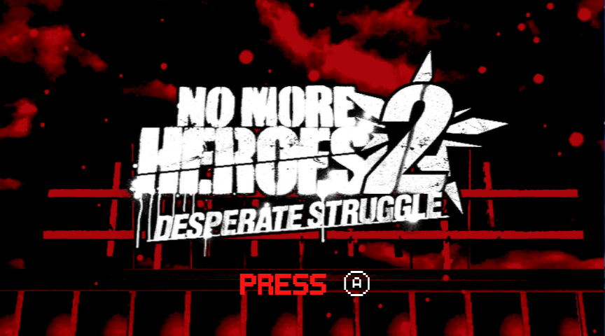
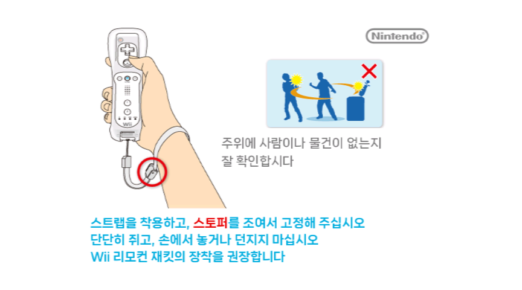
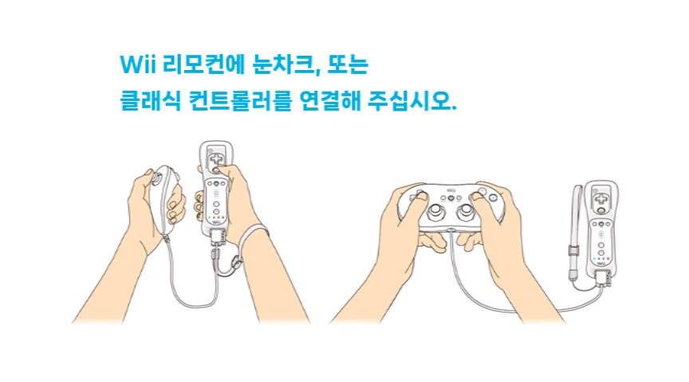
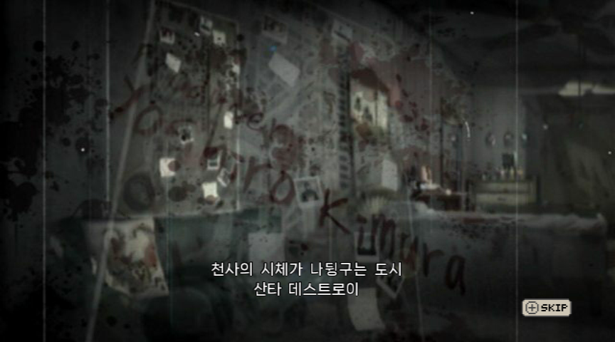
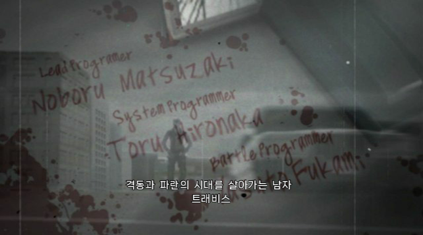
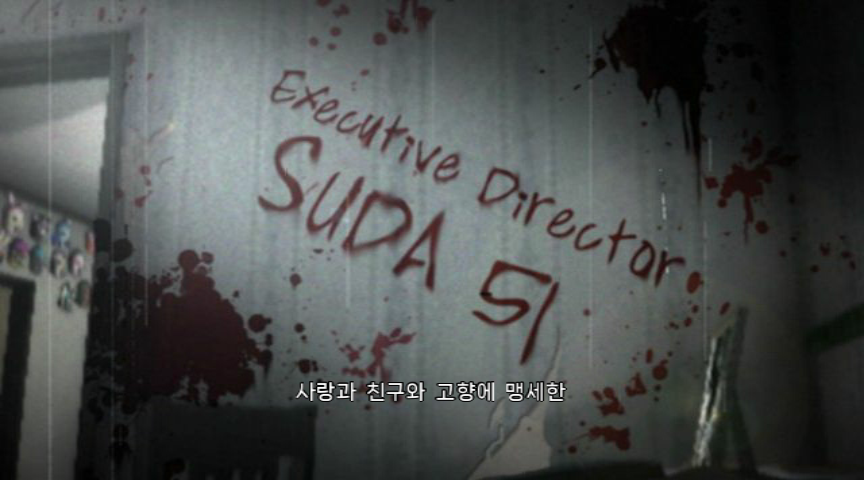
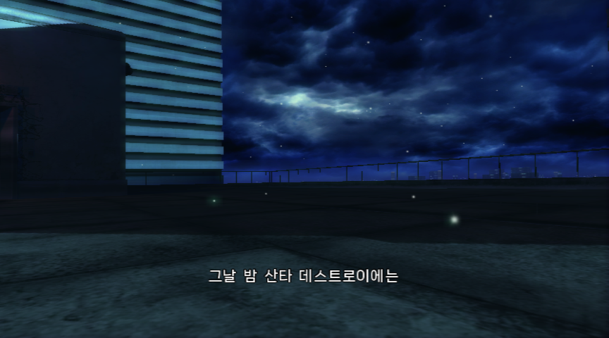
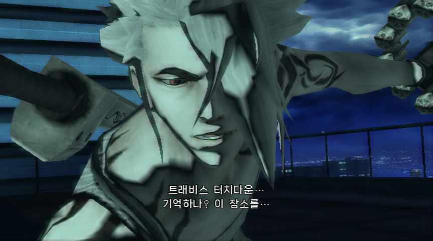
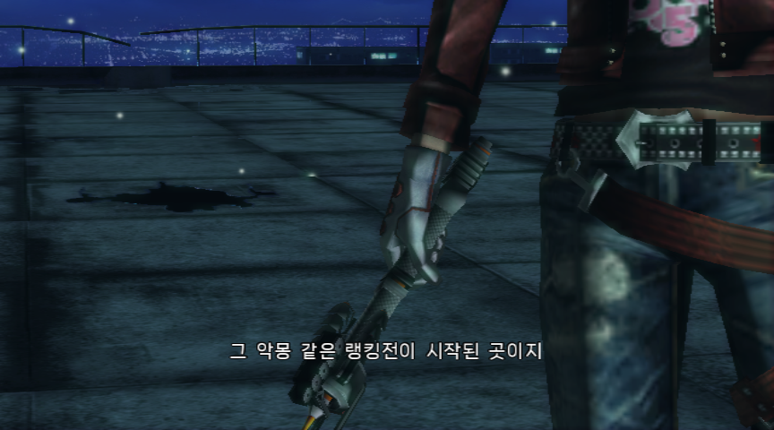
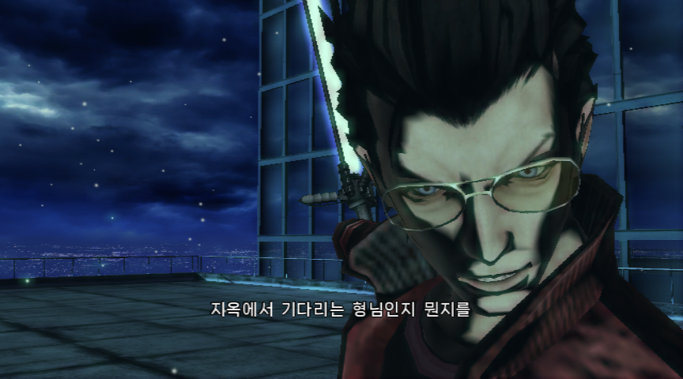

# 노 모어 히어로즈 2 데스퍼레이트 스트러글 Wii 한글패치

Wii 일본판 **노 모어 히어로즈 2 데스퍼레이트 스트러글(ノーモア★ヒーローズ2 デスパレート・ストラグル, RUYJ99)**용 비공식 한국어 패치입니다. 일본판은 영어 음성에 일본어 자막이 붙어 있는데, 이 자막과 게임 안 문장을 한국어로 바꿨습니다.

- **컷신 자막:** 오프닝·스토리 컷신·랭킹전 연출·엔딩 등 동영상과 실시간 컷신 자막 전체
- **게임 내 대화:** 모텔·마을 NPC, 전화·팩스로 전하는 미션 설명, 아르바이트·복수 미션 안내, 상점·짐·고양이 찾기 등
- **튜토리얼·시스템 메시지:** 전투·바이크 튜토리얼, 체력 회복, COLLECTION 입수 안내, 프리 파이트 미션 안내·결과
- **세이브/로드:** Wii 본체 저장 메모리 관련 메시지 51개
- **실행 파일 메시지:** 디스크 오류, Wii 리모컨 연결 끊김·배터리 부족, 컨트롤러 연결 안내 15줄
- **그림 글자:** 스트랩 주의 화면(16:9·4:3), 데스매치 「격파」 화면
- **글꼴:** 각 화면의 일본어 글꼴 영역을 한글 글꼴로 다시 만들었습니다.

약 1,880문장을 직접 번역했습니다. 현재 배포판은 **v1.1 (2026-11-25)**입니다.

[패치 다운로드](https://github.com/snake759494/no-more-heroes-2-wii-korean-patch/releases/latest) · [기술 설명](docs/TECHNICAL.md) · [재빌드](docs/BUILD.md) · [변경 기록](CHANGELOG.md) · [권리 안내](RIGHTS.md)



릴리즈에 첨부한 파일은 한글패치 **NMH2_DS_Wii_KO_v1.1.xdelta** 하나입니다.

저장소에는 제작 소스와 한국어 번역만 공개합니다. 다음 파일은 넣지 않았습니다.
- 원본 디스크 이미지와 패치를 적용한 디스크 이미지
- 게임에서 추출한 파일
- 일본어 원문
- 글꼴 파일과 외부 실행 파일

GitHub가 자동으로 만드는 Source code ZIP/TAR는 저장소 소스를 압축한 것이며, 게임 파일이 아닙니다.

## 게임 소개 및 대상 버전

『노 모어 히어로즈 2 데스퍼레이트 스트러글』은 그래스호퍼 매뉴팩처가 개발하고 마벨러스 엔터테인먼트가 2010년 4월 15일 일본에서 발매한 Wii용 액션 게임입니다. 전작으로부터 3년 뒤, 산타 데스트로이로 돌아온 암살자 트래비스 터치다운이 친구의 복수를 위해 다시 랭킹 1위를 노리고 51명의 암살자 랭킹전에 뛰어듭니다. Wii 리모컨을 휘둘러 빔 카타나로 싸우는 전투, 8비트풍 아르바이트 미니게임과 복수 미션, 짐 트레이닝 등이 들어 있습니다.

이 패치는 **일본판 RUYJ99**에만 적용됩니다. 파일 이름보다 아래 표의 크기와 해시가 맞는지가 중요합니다.

## 적용할 원본

| 항목 | 값 |
| --- | --- |
| 게임 ID | RUYJ99 |
| 원본 형식 | 수정되지 않은 일본판 Wii 디스크 ISO (4,699,979,776 바이트) |
| **원본 ISO MD5** | `13fd4439188415d47919c7875e5e2349` |
| 원본 ISO SHA-1 | `769494e3db6390bfe605089ffb03f3ec43a6e2aa` |
| 원본 ISO SHA-256 | `88c5e748718af6636f97d18097951bb3900095a377ef38f9e65fd122a29a4dd9` |
| (참고) RVZ로 받은 경우 RVZ MD5 | `707f91af8c9dbbee1a2b7d22d7435a31` |
| xdelta 파일 크기 | 985,079,818 바이트 |
| xdelta SHA-256 | `60b215786da8bebcee458fcaf73a856c4715f70f7155e79251ab6a0544a0916b` |
| 적용 결과 ISO 크기 | 4,699,979,776 바이트 |
| 적용 결과 ISO SHA-1 | `52130bd6e4b423a0edf1034358127259e092aef2` |
| 적용 결과 ISO SHA-256 | `cf80c025b96c9aab7bb466f19ac05c0231d7b2acd0398985ebf2ca7e11038d8e` |

원본 게임 파일은 사용자가 직접 준비해야 합니다.

## 패치 적용 방법

### 1. RVZ·WBFS·WIA를 ISO로 바꾸기

xdelta는 **압축하지 않은 ISO**에만 적용됩니다. 원본이 RVZ 등 압축 형식이면 먼저 Dolphin에서 ISO로 바꿉니다.

1. Dolphin 게임 목록에서 게임을 우클릭하고 **파일 변환**을 고릅니다.
2. 형식을 **ISO**로 정하고 변환합니다. 이때 "쓰레기 데이터 제거"는 끄세요. 켜면 해시가 달라집니다.

명령줄에서는 다음과 같이 합니다.

```powershell
.\DolphinTool.exe convert -i '.\No More Heroes 2 - Desperate Struggle (Japan).rvz' -o '.\No More Heroes 2 - Desperate Struggle (Japan).iso' -f iso
```

### 2. 해시 확인

```powershell
Get-FileHash -Algorithm MD5 -LiteralPath '.\No More Heroes 2 - Desperate Struggle (Japan).iso'
```

위 표와 다르면 적용을 중단하세요.

### 3. xdelta UI로 적용

1. 릴리즈에서 `NMH2_DS_Wii_KO_v1.1.xdelta`를 받습니다.
2. xdelta3 패치를 지원하는 도구에서 **Apply Patch** 기능을 엽니다.
3. **Patch**에는 xdelta 파일을, **Source File**에는 해시가 일치하는 원본 `.iso`를 선택합니다.
4. **Output File**에는 새 파일 이름을 지정합니다(예: `No More Heroes 2 - Desperate Struggle (Korean).iso`).

xdelta는 호환성을 위해 압축·2차 압축·파일 경로 헤더 없이 만들었습니다. xdelta 자체는 [공식 프로젝트](https://github.com/jmacd/xdelta)를 참고하세요.

### 명령줄로 적용

```powershell
.\xdelta3.exe -d -s '.\No More Heroes 2 - Desperate Struggle (Japan).iso' '.\NMH2_DS_Wii_KO_v1.1.xdelta' '.\No More Heroes 2 - Desperate Struggle (Korean).iso'
```

결과 ISO는 Dolphin에서 그대로 실행하거나, 원하면 다시 RVZ로 변환해 보관해도 됩니다.

**세이브**
- 게임 ID는 원본과 같으므로 Wii 세이브 데이터는 원본판과 함께 쓸 수 있습니다.
- 원본판에서 만든 세이브 스테이트는 쓰지 마세요.

## 스크린샷

| | |
| --- | --- |
|  |  |
|  |  |
|  |  |
|  |  |



## 한글화 범위

- **대사·자막(GDLG):** 동영상·컷신 자막과 게임 내 대화, 미션 안내, 튜토리얼 등 고유 문장 약 1,780개
- **이벤트 문장(Shift-JIS GDLG):** 프리 파이트 미션 안내·결과 등 36개
- **세이브/로드 메시지:** 51개
- **실행 파일(`main.dol`):** 디스크·리모컨·컨트롤러 시스템 메시지 15줄
- **글꼴:** 각 문장 묶음에 딸린 글꼴 이미지를 한글 글꼴로 다시 생성
- **그림 글자:** 스트랩 주의 화면 2종, 데스매치 「격파」
- **원문 유지:** 영어 음성, 메뉴·HUD(일본판도 영어 그림), 스태프롤, 동영상 속에 새겨진 글자, Wii 메뉴의 채널·세이브 파일 이름(본체 글꼴 사용)

## 알려진 한계

**확인 범위**
- Dolphin에서 직접 확인한 범위는 다음과 같습니다.
  - 스트랩 안내, 오프닝, 타이틀, 난이도 선택, 첫 보스전과 컷신, 랭킹 결과, 모텔 진입·TV 메뉴, 아르바이트 미니게임
- 그 뒤 스테이지와 상점·미션 대사는 텍스트 단위로 검증했지만 모두 플레이해 보지는 못했습니다.
- 실기 Wii에서의 동작은 확인하지 못했습니다. 결과 ISO는 가짜 서명이므로 실기에서는 USB 로더 등 서명 검사를 하지 않는 환경이 필요합니다.

진행이 멈추거나 글자가 깨지는 곳이 있으면 이슈로 알려 주세요. 스크린샷과 장소를 함께 올려 주시면 빨리 고칠 수 있습니다.

## 재빌드

[docs/BUILD.md](docs/BUILD.md)를 참고하세요.
